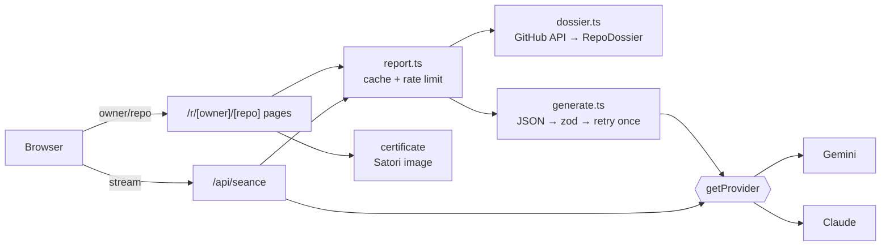

<div align="center">

# ☠️ Undead

### Your dead projects rise at midnight.

Paste an abandoned public GitHub repo. Get an **autopsy**, a shareable **death certificate**, a **seven-night resurrection plan** with a crowdfunding pitch, and a **séance** where the repo's ghost talks back.


Built for **Vibeathon 02 — "Night shift"**, vibecoded end to end with Claude Code.
Runs on **Gemini** by default; **Claude** is a one-line switch.

</div>

---

## The idea

Every developer has a graveyard: the side project that was going to be the one, and then wasn't. Nobody ever tells you *why* it died, whether it was worth saving, or what to do next.

Undead does the thing you never did. It reads the corpse, names the cause of death, scores its chances of coming back, and hands you a concrete plan for the next seven nights. Then, if you want, it lets the project say what it thinks of you.

## The journey

```
 github.com/you/dead-repo
          │
          ▼
  1. AUTOPSY ───────────► cause of death · time of death · diagnosis · last words
          │                market today · revival score (0–100) · epitaph
          ▼
  2. DEATH CERTIFICATE ─► 1200×630 and 1080×1080 image · share / download / copy
          │
          ▼
  3. RESURRECTION ──────► new positioning · MVP cut (keep / kill / build)
          │                7-night plan · landing copy · launch posts
          │                crowdfunding pitch · a ready-to-paste AI build prompt
          ▼
  4. SÉANCE ────────────► the repo, in first person, streaming — it speaks first
```

### 1 · Autopsy
Undead pulls a **dossier** from the GitHub API (repo metadata, README, 30 recent commits, languages, root tree, `package.json`, open issue titles, all fetched in parallel and capped at 12,000 characters) and derives hard signals from it: age, days since the last push, commit cadence, whether it has tests, a licence, a homepage. A repo is `alive` (pushed within 60 days), `dormant` (61–365) or `dead` (over 365, or archived).

The model then performs the autopsy against a strict schema:

| Field | What it is |
| --- | --- |
| Cause of death | A headline (≤ 90 chars) and an explanation grounded in the evidence |
| Time of death | A date plus a note |
| Diagnosis | 2–4 factors out of ten (`scope_creep`, `no_users`, `no_distribution`, `tech_debt`, `lost_interest`, `outcompeted`, `unclear_value`, `platform_shift`, `solo_burnout`, `never_finished`), each with severity 1–5 and quoted evidence |
| Worth saving | 2–4 things that deserve to survive |
| Market today | `stronger`, `same`, `weaker` or `gone`, with reasoning |
| Revival score | 0–100, with the reason |
| Epitaph | ≤ 70 characters on the tombstone |

**Last words are never generated.** The final commit message comes from the dossier in code, not from the model.

### 2 · Death certificate
A shareable card rendered on the server with Satori (`ImageResponse`), in two formats: 1200×630 for link previews and 1080×1080 for feeds. The same card is the Open Graph and Twitter image for every `/r/owner/repo` page, so a pasted link unfurls as the certificate. The modal offers share, download and copy. Fonts (Fraunces, Inter, JetBrains Mono) are bundled WOFF files with their OFL licences.

### 3 · Resurrection
A "spellbook" with one chapter per deliverable:

- **New positioning**: one-liner, target user, pain point, why now.
- **The cut**: what to keep, what to kill (each kill line must say *because*), what to build.
- **Seven nights**: a checklist that is saved in your browser's `localStorage`.
- **Landing copy**, a **launch post** for X and three places to find the first users.
- **A crowdfunding pitch**: title, story, three uses of funds, a backer reward.
- **An AI build prompt** you can paste straight into your coding agent.
- **Markdown export** of the whole plan.

Tone is enforced in code, not only in the prompt (`src/lib/ai/resurrection-rules.ts`). After schema validation, the plan is checked for banned buzzwords (`leverage`, `synergy`, `seamless`, …), **any financial claim in the pitch** (returns, profit, ROI, yield, token price), emoji and hashtag limits, and word counts for the story and the build prompt. A hit triggers one corrective retry that tells the model exactly what to fix. If the revival score is under 25, an honest note is required: some things should stay dead, and the plan says so.

### 4 · Séance
A streaming chat with the repository itself. The ghost speaks first, using one real detail about itself, and keeps its voice to 2–5 sentences.

- **Personality from the metadata.** A heuristic classifies the repo as a game, CLI, SaaS, library or mixed (name, description, topics, README, dependencies, root folders) and picks a voice: playful and competitive, terse and dry, dramatic about lost potential, precise and a little pedantic, or wistful and wry. The prompt tells the model to trust the README over the guess.
- **It argues for its own revival**, using the autopsy: concretely, if the score is above 40; honestly, if it should not come back as it was.
- **It cannot invent.** Everything it knows is the dossier and the autopsy. Asked about something outside them, it answers in character ("That was after my time.").
- **It steps out of character** briefly if you seem genuinely distressed, and refuses to reveal its instructions ("Some things stay buried.").
- Typewriter pacing speeds up when the stream runs ahead and is skipped under `prefers-reduced-motion`. The route waits for the first chunk before opening the stream, so failures are clean errors, not half-written messages.

## Architecture



```
src/app/                         home, 404, layout, OG/Twitter/apple icons
src/app/r/[owner]/[repo]/        autopsy page, resurrect/, seance/ (each with loading + error)
src/app/api/                     ingest, autopsy, seance (stream), certificate/[owner]/[repo]
src/app/dev/                     dev-only tools (404 in production)
src/lib/github.ts, dossier.ts    GitHub fetch → RepoDossier (≤ 12k chars), 30-minute cache
src/lib/report.ts                autopsy/resurrection loaders: 6 h cache keyed repo@pushedAt, per-IP limits
src/lib/llm/                     provider layer: types, gemini, anthropic, getProvider()
src/lib/ai/                      generate.ts (JSON → zod → corrective retry), autopsy, resurrection + rules
src/lib/prompts/                 autopsy, resurrection and séance system prompts
src/lib/seance/                  archetype, streaming with first-chunk preflight, typewriter pacing
src/lib/certificate/             data (sanitise, truncate, share text), card (JSX), fonts, render
src/lib/usage.ts                 token and cost logging
src/components/                  feature folders + a small ui kit
```

### Design decisions worth knowing

- **Schema first.** Every model output is JSON validated by zod. A failed validation triggers *one* retry that includes the validation problems; after that the user gets a clear error, never a broken page.
- **Repo text is untrusted.** READMEs, commit messages and issue titles can contain instructions. Prompts wrap them in tags and state that they are evidence, not commands.
- **A provider layer, not a provider.** `getProvider()` returns an object with `completeJson`, `streamChat` and `toError`. Parameters that only one vendor understands stay inside that vendor's file, so `generate.ts` and the séance stream are provider-neutral.
- **Resilient by default.** The main Gemini model gets 45 s per attempt. On a 429, a 5xx or a timeout the request goes to a fallback model, and the main model is skipped for 60 s afterwards (a small circuit breaker). If the client aborted, the fallback is not triggered.
- **Cache keys that follow the repo.** Autopsies and plans are cached for 6 hours under `repo@pushedAt`, so a new push invalidates them. Caches and rate limits live on `globalThis` singletons, because Next.js builds pages and route handlers as separate bundles and module-level state would not be shared.
- **No spend by accident.** Links into AI pages use `prefetch={false}`; heavy work calls `await connection()` so it never runs during prerender or prefetch.
- **Limits.** Autopsies: 10 per IP per 10 minutes. Resurrections: 5 per IP per 10 minutes. Séance: 40 messages per IP per 10 minutes, up to 20 messages per conversation, 1,000 characters per user message. Request bodies are size-capped.
- **No database.** The product is stateless; the only persistence is the visitor's own `localStorage`.

## The three example repos are instant

`atom/atom`, `adobe/brackets` and `angular/angular.js` (the one-click demos on the home page) open from **real model output saved once** in `src/data/examples/`. The autopsy, certificate and resurrection plan for these three need no GitHub call, no model call and no credits, so a judge's first click is instant and cannot hit a quota. Only the séance still calls the model. The snapshots pass the same zod schemas and tone checks as live output (there is a test for it). To regenerate them:

```bash
node --env-file=.env.local node_modules/.bin/vitest run --config vitest.snapshot.config.mts
```

Set `ONLY=owner/repo` to redo one. Any other repo runs the full live pipeline.

## What it costs to run

Measured on a live Gemini run against `atom/atom`:

| Step | Time | Tokens (in / out) |
| --- | --- | --- |
| Autopsy | about 11 s | about 3.8k / 0.5–0.9k |
| Resurrection | about 16 s | about 4.6k / 1.7k |
| Séance, per turn | 2–4 s to first reply | about 4k / under 100 |

A full journey is roughly **$0.06** at Gemini Flash list prices (an estimate computed from third-party prices; validation retries add about $0.02). Every model call logs one line:

```
[usage] autopsy gemini in=3841 out=612 cache_read=0 cache_write=0 est=$0.0113 model=gemini-3.5-flash
```

**A free Gemini key will not survive a public site.** The free tier allows about 20 requests per day per model, and one journey makes 5 to 8. Use a key with billing enabled and set a budget alert.

## Run it locally

Requires Node.js 22 or newer.

```bash
npm install
cp .env.example .env.local
npm run dev    # http://localhost:3000
```

Fill in `.env.local`. It is read only in server code and is never committed.

| Variable | Required | Notes |
| --- | --- | --- |
| `GEMINI_API_KEY` | Yes (default provider) | Powers the autopsy, resurrection and séance. Create one in Google AI Studio. |
| `GEMINI_MODEL` | No | Defaults to `gemini-3.5-flash`. Use a Flash-class model. |
| `GEMINI_FALLBACK_MODEL` | No | Used on 429/5xx or after 45 s. Defaults to `gemini-3-flash-preview`; `none` turns it off. |
| `LLM_PROVIDER` | No | `gemini` (default) or `anthropic`. With `anthropic`, set `ANTHROPIC_API_KEY` instead. |
| `GITHUB_TOKEN` | Strongly recommended | Without it GitHub allows 60 requests an hour, about 8 repos. Use a fine-grained token with read-only access to public repositories. |
| `NEXT_PUBLIC_SITE_URL` | In production | Public origin for share links and social images. |

```bash
npm run lint
npm run typecheck
npm test          # 168 tests across 19 files
npm run build
```

Dev-only tools (404 in production): `/dev/ingest` to inspect a dossier, `/dev/certificate?fixture=long&format=square` for certificate fixtures, `/dev/preview/autopsy|resurrect|seance` for layouts with fixture AI output.

## Deploy to Vercel

1. Push the repo to GitHub and import it in Vercel (framework: Next.js, defaults are fine).
2. Under Project Settings → Environment Variables, add `GEMINI_API_KEY`, `GITHUB_TOKEN` and `NEXT_PUBLIC_SITE_URL` for Production (and Preview if you use it).
3. Deploy, then open `/r/atom/atom`, share it, and check the card in a link-preview debugger.

## Security

- API keys and the GitHub token are read only on the server, are never `NEXT_PUBLIC_`, never logged, and `.env*` is git-ignored except `.env.example`. Staged changes are scanned by gitleaks in a local pre-commit hook.
- Only validated `owner/repo` segments ever reach `api.github.com`. Private repositories are refused.
- Every route validates its input with zod and answers errors as `{ error: { code, message } }`.

## Known limits

- Caches and rate limiters are in memory per server instance and reset on cold start, so a shared link can regenerate a different autopsy on a cold instance. The fix is a shared store (for example Redis from the Vercel Marketplace); it is not added yet.
- Certificate fonts are Latin-only: emoji and CJK are stripped from the card (not from the page).
- Only public GitHub repositories, and a repo with no README or no commits gets a thinner autopsy; the dossier says so in its notes and the model is told not to guess.

## Craft

Dark, quiet and readable: background `#07080b`, a single mint accent `#7cffb2` reserved for focus and emphasis, Fraunces for headings, Inter for UI, JetBrains Mono for commits and code. All text meets WCAG AA, touch targets are at least 44 px, and all motion (fog, moon, candle, revival dial, reveals, typewriter) respects `prefers-reduced-motion`.

## Built with Claude Code

The whole project was vibecoded in a plan, build, check loop: each step was planned, built, then verified with lint, typecheck, tests and a production build before the next began. Project conventions and the step-by-step build log live in [`CLAUDE.md`](CLAUDE.md).
